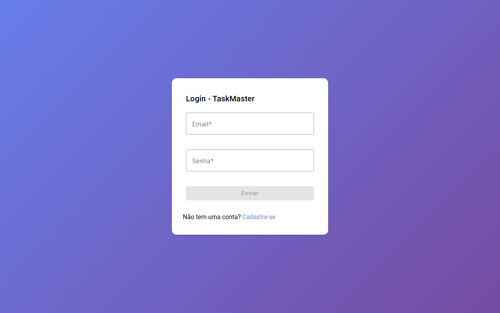
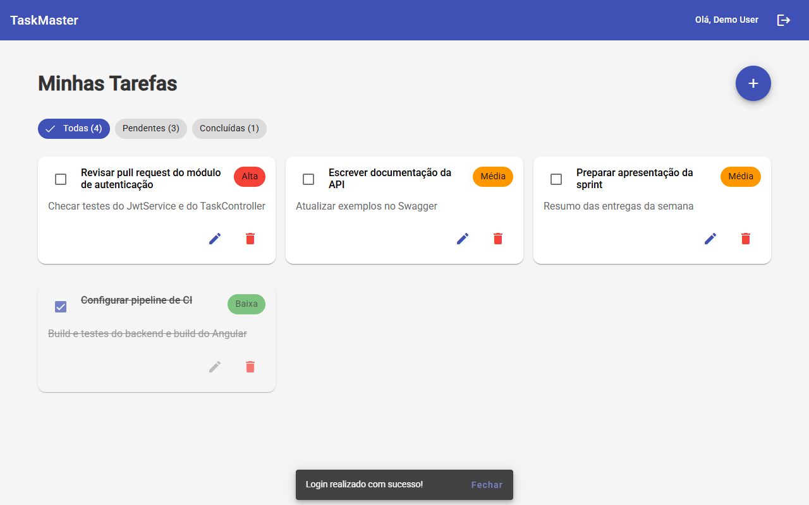

# 📋 TaskMaster - Sistema de Gerenciamento de Tarefas

<div align="center">


[](https://github.com/TiagoAReiz/TaskManager/actions/workflows/ci.yml)

Uma aplicação completa de gerenciamento de tarefas desenvolvida com **Clean Architecture**, seguindo as melhores práticas de desenvolvimento e DevOps.

</div>

## 🚀 Visão Geral

TaskMaster é uma aplicação moderna de gerenciamento de tarefas que permite aos usuários criar, organizar e acompanhar suas atividades de forma eficiente. O sistema é construído com uma arquitetura robusta e escalável, utilizando as tecnologias mais atuais do mercado.

### 🎯 Principais Funcionalidades

- ✅ **Autenticação JWT** - Sistema seguro de login e registro
- 📝 **CRUD Completo de Tarefas** - Criar, listar, editar e excluir tarefas
- 🏷️ **Sistema de Prioridades** - LOW, MEDIUM, HIGH
- 📊 **Status de Tarefas** - PENDING, IN_PROGRESS, COMPLETED
- 📅 **Gerenciamento de Prazos** - Data limite e tarefas em atraso
- 🔍 **Filtros Avançados** - Por status, prioridade e data
- 📱 **Interface Responsiva** - Desenvolvida com Angular Material
- 🛡️ **Segurança Robusta** - Proteção de rotas e validação de dados
- 📖 **Documentação API** - Swagger/OpenAPI integrado

### 📸 Screenshots

Capturas da aplicação rodando localmente via `docker compose` (dados de demonstração):

| Login | Minhas Tarefas |
|-------|----------------|
|  |  |

## 🏗️ Arquitetura

### Backend - Clean Architecture

O backend segue os princípios da **Clean Architecture**, garantindo separação de responsabilidades e alta testabilidade:

```
📂 taskManager/src/main/java/com/tiagoreiz/projeto/
├── 🎯 Core/                    # Camada de Domínio
│   ├── Entities/              # Entidades de negócio
│   ├── Repositories/          # Interfaces de repositório
│   └── Exceptions/            # Exceções personalizadas
├── 🔧 Application/            # Camada de Aplicação
│   ├── Commands/              # DTOs de comando
│   └── UseCases/              # Casos de uso (regras de negócio)
├── 🌐 Adapters/               # Camada de Interface
│   ├── Controllers/           # Controllers REST
│   ├── DTOs/                  # Data Transfer Objects
│   └── Mappers/               # Mapeadores (MapStruct)
├── 🔌 Infra/                  # Camada de Infraestrutura
│   ├── Persistence/           # Implementação JPA
│   └── Security/              # Configurações de segurança
└── 📱 TaskManagerApplication   # Classe principal
```

### Frontend - Angular Modular

```
📂 frontend/src/app/
├── 🔐 auth/                   # Módulo de Autenticação
│   └── components/            # Login e Registro
├── 📋 tasks/                  # Módulo de Tarefas
│   ├── components/            # Lista, Item, Dialog de tarefas
│   └── services/              # Serviços de API
├── 🛡️ core/                   # Serviços centrais
│   ├── guards/                # Guards de rota
│   └── services/              # Serviços compartilhados
└── 🎨 shared/                 # Componentes compartilhados
    └── components/            # Layout, Navbar
```

## 🛠️ Tecnologias Utilizadas

### Backend
- **Java 17** - Linguagem principal
- **Spring Boot 3.2.0** - Framework principal
- **Spring Security** - Segurança e autenticação
- **Spring Data JPA** - Persistência de dados
- **PostgreSQL** - Banco de dados relacional
- **JWT** - Autenticação baseada em tokens
- **MapStruct** - Mapeamento de objetos
- **Lombok** - Redução de código boilerplate
- **SpringDoc OpenAPI** - Documentação da API
- **Maven** - Gerenciamento de dependências

### Frontend
- **Angular 20.1.0** - Framework frontend
- **Angular Material** - Biblioteca de componentes UI
- **TypeScript** - Linguagem tipada
- **RxJS** - Programação reativa
- **SCSS** - Pré-processador CSS
- **Angular CLI** - Ferramentas de desenvolvimento

### DevOps & Infraestrutura
- **Docker & Docker Compose** - Containerização
- **Nginx** - Servidor web e proxy reverso
- **GitHub Actions** - CI/CD
- **Azure Container Registry** - Registro de imagens
- **Azure App Service** - Hospedagem
- **Azure Database for PostgreSQL** - Banco em nuvem

## 🐳 Execução com Docker

### Pré-requisitos
- Docker 20.10+
- Docker Compose 2.0+

### 🚀 Inicio Rápido

```bash
# 1. Clone o repositório
git clone https://github.com/TiagoAReiz/TaskManager.git
cd TaskManager

# 2. Configure as variáveis de ambiente
cp .env.example .env
# Edite o .env e defina POSTGRES_PASSWORD e JWT_SECRET (obrigatórios)
# Ex.: JWT_SECRET=$(openssl rand -base64 48)

# 3. Gere o build do frontend (o Nginx serve frontend/dist/frontend/browser)
cd frontend && npm ci && npm run build && cd ..

# 4. Execute a aplicação
docker compose up --build

# 5. Acesse a aplicação
# Frontend: http://localhost
# Backend API: http://localhost:8080/api
# Swagger UI: http://localhost:8080/swagger-ui.html
# Health check: http://localhost:8080/actuator/health
# Adminer (dev): http://localhost:8081
```

### 🛠️ Comandos Úteis

```bash
# Executar apenas serviços principais
docker compose up postgres-db backend frontend

# Executar com Adminer para desenvolvimento
docker compose --profile dev up

# Ver logs de um serviço específico
docker compose logs -f backend

# Rebuild completo
docker compose build --no-cache
docker compose up --force-recreate

# Parar e remover volumes (dados serão perdidos)
docker compose down -v
```

## 🚀 Desenvolvimento Local

### Backend

```bash
cd taskManager

# Compilar e testar
mvn clean test

# Executar localmente (certifique-se que o PostgreSQL está rodando)
# Os segredos vêm de variáveis de ambiente — não há senhas no application.properties
export SPRING_DATASOURCE_PASSWORD=<senha-do-postgres>
export JWT_SECRET=<string-aleatoria-com-32+-caracteres>
mvn spring-boot:run

# Build para produção
mvn clean package -DskipTests
```

### Frontend

```bash
cd frontend

# Instalar dependências
npm install

# Executar em modo de desenvolvimento (http://localhost:4200)
# As chamadas para /api são redirecionadas para http://localhost:8080 via proxy.conf.json
npx ng serve

# Build para produção
npm run build
```

## 📋 API Endpoints

### Autenticação
```http
POST /api/auth/register     # Registrar usuário
POST /api/auth/login        # Login
GET  /api/auth/status       # Status da API
```

### Tarefas (Autenticação necessária)
```http
GET    /api/tasks                    # Listar tarefas
POST   /api/tasks                    # Criar tarefa
GET    /api/tasks/{id}               # Buscar tarefa por ID
PUT    /api/tasks/{id}               # Atualizar tarefa
DELETE /api/tasks/{id}               # Deletar tarefa
PATCH  /api/tasks/{id}/status        # Atualizar status
GET    /api/tasks/overdue            # Listar tarefas atrasadas

# Filtros disponíveis
GET /api/tasks?status=PENDING&priority=HIGH
```

### Parâmetros de Filtro
- **status**: `PENDING`, `IN_PROGRESS`, `COMPLETED`
- **priority**: `LOW`, `MEDIUM`, `HIGH`

## 📊 Banco de Dados

### Modelo de Dados

```sql
-- Tabela de Usuários
CREATE TABLE users (
    id BIGSERIAL PRIMARY KEY,
    name VARCHAR(100) NOT NULL,
    email VARCHAR(150) UNIQUE NOT NULL,
    password VARCHAR(255) NOT NULL,
    created_at TIMESTAMP NOT NULL DEFAULT NOW(),
    updated_at TIMESTAMP NOT NULL DEFAULT NOW()
);

-- Tabela de Tarefas
CREATE TABLE tasks (
    id BIGSERIAL PRIMARY KEY,
    title VARCHAR(200) NOT NULL,
    description TEXT,
    status VARCHAR(20) NOT NULL DEFAULT 'PENDING',
    priority VARCHAR(20) NOT NULL,
    created_at TIMESTAMP NOT NULL DEFAULT NOW(),
    updated_at TIMESTAMP NOT NULL DEFAULT NOW(),
    due_date TIMESTAMP,
    completed_at TIMESTAMP,
    user_id BIGINT NOT NULL REFERENCES users(id)
);
```

## 🔧 Configuração

### Variáveis de Ambiente

Todas as variáveis estão documentadas em [`.env.example`](./.env.example). Copie para `.env` (ignorado pelo Git) e defina valores próprios:

```bash
# Banco de Dados
POSTGRES_DB=taskmaster
POSTGRES_USER=taskmaster_user
POSTGRES_PASSWORD=change-me            # obrigatório

# JWT
JWT_SECRET=change-me-to-a-random-string-with-at-least-32-chars   # obrigatório
JWT_EXPIRATION=86400000

# Aplicação
SPRING_PROFILES_ACTIVE=docker
SERVER_PORT=8080
LOGGING_LEVEL_COM_TIAGOREIZ=DEBUG
```

### Profiles Spring Boot
- **default**: Desenvolvimento local
- **docker**: Execução em containers
- **azure**: Produção no Azure

## 🌐 Deploy em Produção

### Azure App Service

O projeto inclui um pipeline de deploy para Azure em `.github/workflows/deploy-to-azure.yml`.
Ele é executado **manualmente** (`workflow_dispatch`), pois depende de recursos Azure e de secrets
do repositório (ACR, App Service, Service Principal) que precisam ser provisionados antes.
A integração contínua (build + testes a cada push/PR) roda no workflow [`ci.yml`](./.github/workflows/ci.yml).

Etapas do pipeline de deploy:

1. **Testes** do backend antes do build
2. **Build automático** das imagens Docker
3. **Deploy no Azure Container Registry**
4. **Deploy no Azure App Service**
5. **Health checks** automáticos

Consulte o [DEPLOYMENT_GUIDE.md](./DEPLOYMENT_GUIDE.md) para instruções detalhadas.

### Recursos Azure Necessários
- Azure Container Registry
- Azure Database for PostgreSQL
- Azure App Service
- Service Principal para GitHub Actions

## 🔒 Segurança

### Implementações de Segurança
- **Autenticação JWT** com tokens seguros
- **Criptografia de senhas** com BCrypt
- **Validação de entrada** em todos os endpoints
- **CORS** configurado adequadamente
- **Headers de segurança** no Nginx
- **Rate limiting** (configurável)
- **Validação de propriedade** das tarefas

### Boas Práticas
- Secrets não commitados no código
- Senhas fortes obrigatórias
- Tokens com expiração configurável
- Logs de segurança detalhados

## 📖 Documentação da API

A documentação completa da API está disponível via Swagger UI:

- **Desenvolvimento**: http://localhost:8080/swagger-ui.html
- **Produção**: https://your-app.azurewebsites.net/swagger-ui.html

### Recursos da Documentação
- Todos os endpoints documentados
- Exemplos de request/response
- Modelos de dados
- Códigos de status HTTP
- Autenticação via interface

## 🧪 Testes

### Backend
Testes unitários (JUnit 5 + Mockito + AssertJ) para entidades de domínio, casos de uso e `JwtService`,
além de um teste de fatia web (`@WebMvcTest`) do `TaskController` com a configuração real de segurança JWT.

```bash
cd taskManager

# Executar todos os testes
mvn test

# Executar testes com relatório de cobertura (target/site/jacoco/index.html)
mvn test jacoco:report
```

### Integração Contínua
O workflow [`ci.yml`](./.github/workflows/ci.yml) roda em cada push e pull request:
- **Backend**: `mvn verify` (compilação + testes) com JDK 17
- **Frontend**: `npm ci` + `npm run build` com Node.js 22

## 🔍 Monitoramento

### Health Checks
- **Backend**: `/actuator/health`
- **Frontend**: `/health`
- **Database**: Verificação automática via Spring Actuator

### Métricas Disponíveis
- Status da aplicação
- Métricas de performance
- Status do banco de dados
- Logs estruturados

## 🤝 Contribuição

### Como Contribuir
1. Fork o projeto
2. Crie uma branch para sua feature (`git checkout -b feature/AmazingFeature`)
3. Commit suas mudanças (`git commit -m 'Add some AmazingFeature'`)
4. Push para a branch (`git push origin feature/AmazingFeature`)
5. Abra um Pull Request

### Padrões de Código
- Seguir convenções Java/Spring Boot
- Usar TypeScript no frontend
- Testes obrigatórios para novas funcionalidades
- Documentação atualizada

## 📄 Licença

Este projeto está licenciado sob a licença MIT - veja o arquivo [LICENSE](LICENSE) para detalhes.

## 👨‍💻 Autor

**Tiago Reiz**
- GitHub: [@TiagoAReiz](https://github.com/TiagoAReiz)
- LinkedIn: [Tiago Reiz](https://linkedin.com/in/tiagoreiz)

## 🙏 Agradecimentos

- Clean Architecture por Robert Martin
- Spring Framework Team
- Angular Team
- Comunidade open source

---

<div align="center">

**⭐ Se este projeto foi útil, considere dar uma estrela!**

</div>